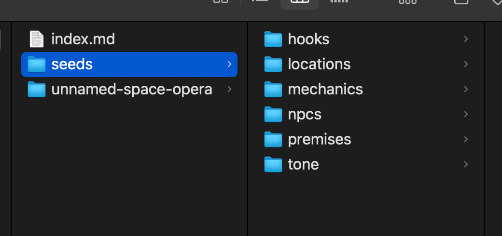

I acknowledge up-front the huge barrier to entry the [GM-Apprentice](https://github.com/AntTheLimey/gm-apprentice) currently has:

1.  You have to be using an AI that leverages skills - and probably requires a subscription. I mean right now its all currently written for Claude Code or Claude Desktop
2.  You have to be savvy/experienced enough to get the skills installed
3.  You have to be into tabletop Roleplaying games AND not automatically hating the concept of using AI to assist you

Regardless, I continue to build it out, because its useful to me, both for running my games, and for my professional learning.

Anyway. If you are a part of that small venn-diagram, I want to tell you about the new Skill I’ve added to the plugin: **The Midwife**

She is called the Midwife because her purpose is to help you birth your ideas.  Not just because oh no I’m stuck, “better call the midwife” … but also because theres a very deliberate line in there: she is helping you bring forth YOUR ideas. It is YOUR baby, not hers.  She may suggest, she may offer ideas, but she does NOT create her own story.  She won’t go running off and writing up a whole adventure and spew tons of content you didnt want. Her goal, her very specific goal, is to tease your adventure out of you, no matter how big or small, no matter how little you have to start with, and get you to a point where the Campaign-organizer skill can take over and get it written up to start, and the session-prep skill can get you planned out for your first session

Maybe the best way to introduce her is just to show the beginning of a conversation with her.  I started up Claude Code in an empty directory (imaginatively called ‘test-adventure’ =P) and asked:

> /gm-apprentice:the-midwife I want to create a new adventure but I have no idea where to start

```
Let me check for a vault and read the session principles first.

Bash(test -f meta/vault-config.md && echo "VAULTFOUND" || echo "NO_VAULT")
  ⎿  NO_VAULT

I don't see a campaign vault here. This is a completely fresh start — perfect.
  Let me set up the workspace, and then we'll find your adventure together.

Bash(mkdir -p _midwife/seeds/{premises,npcs,locations,hooks,tone,mechanics})
  ⎿  Done
Write(_midwife/index.md)

Workspace is ready. Now — no pressure, no wrong answers here. Starting from nothing is actually a great place to be.
  What's pulling at you? It could be anything:
 - A genre — noir, cosmic horror, swashbuckling, political intrigue, weird west...
  - A scene you've imagined — maybe a moment, an image, a confrontation
  - A feeling you want at the table — dread, wonder, moral complexity, dark comedy
  - A system you've been wanting to run — or one you know you want to use
  - A theme — identity, colonialism, legacy, what people do when cornered
  - Literally nothing at all — and I'll throw you three sparks to react to
  What've you got?
```

So there we go - one Prompt, and we already got a base file structure in place to save everything.  The Midwife writes as we go - we dont want to lose things to context compression, or session interruption



She also writes a “seed bank” as she goes. Any idea that is brought up, spit-balled, considered, and rejected, she throws in the seed bank for the next time you need ideas.  This gives you, and her, a library to draw upon, the more you use her

Ok lets continue:

> **I got literally nothing, hit me with some sparks**

```
Right. Three sparks, each a different flavour. React to whichever one makes something twitch in your brain — or tell me they're all rubbish and I'll throw three more.

  1. "The Debt Collectors" — Dark comedy meets heist

  A group of desperate people are hired to repossess impossible things — a stolen memory, a saint's last breath, a debt owed by a dead man — in a city where everything has a price and nothing is what it's worth.

  2. "The Last Light" — Creeping dread meets frontier survival

  A remote community — lighthouse, research station, mining outpost — goes silent. The people sent to find out why discover that the residents didn't leave, and didn't exactly die either. Something about the place changed them, and it's starting to work on the newcomers too.

  3. "The Accord" — Political intrigue meets ticking clock

  Three factions have maintained an uneasy peace for a generation, but the treaty is about to expire. The PCs are caught in the middle — by loyalty, by accident, or by design — as every faction manoeuvres to be on top when the clock runs out. Nobody wants war. Everybody is preparing for it.

 Which one wants to grow? Or if none of them land, tell me what's wrong with them — that's just as useful.
```

> **Nah I'm feeling something Space Opera & Military.  Something like the Sten books by Alan Cole and Chris Bunch.  I want a starting adventure that gets the group recruited by the Eternal Emperors private spy (although they dont know that yet)**

```
Now we're cooking. The Sten books are a brilliant well to draw from — that blend of gritty military action, espionage, dark humour, and a universe where power is absolute and loyalty is the most dangerous currency.

  Let me capture what you've given me.

Write(_midwife/unnamed-space-opera/index.md)

  ⎿  Wrote 29 lines to _midwife/unnamed-space-opera/index.md
        # Unnamed Space Opera Adventure
       Status: Discover
       Current thread: Initial concept shaping
       ## Core Seed
       - Genre: Space opera + military
       - Inspiration: The Sten books (Alan Cole & Chris Bunch)
      - Starting adventure: PCs get recruited by the Eternal Emperor's private spy/black ops agency
     … +19 lines (ctrl+o to expand)

Good stuff. So the Sten DNA gives us a lot to work with — the Eternal Emperor, AM2 as the economic chokepoint, Mercury Corps as the shadow within the shadow, that sense of being a small cog in an impossibly vast machine who slowly realises they're working for the man behind everything.

How much Sten do you want to borrow versus build fresh? I see a spectrum:

  - Serial numbers filed off — You build your own emperor, your own empire, your own fuel monopoly, but the architecture is pure Sten. Different names, same bones. Freedom to diverge whenever you want.

  - Sten-adjacent — Borrow the big concepts (Eternal Emperor, AM2, the idea of Mercury Corps) but reshape the politics, factions, and history to suit your table. Players who've read the books get a thrill of recognition but can't predict anything.

  - Straight Sten — Run it in that universe. The Emperor is the Emperor, Mantis Section exists, the Tahn are out there. You're writing new stories in an established world.

  Which end of that spectrum feels right — or somewhere in between?
```

> **serial numbers filed off, build our own universe**

```
Perfect. That's the most fun anyway — all the structural DNA, none of the constraints.

Write(_midwife/unnamed-space-opera/discoveries.md)
  ⎿  Wrote 17 lines to _midwife/unnamed-space-opera/discoveries.md
       # Discoveries
       ## Inspirations & Constraints
       - Primary inspiration: Sten books (Cole & Bunch)
       - Approach: Serial numbers filed off — build original universe using Sten's structural DNA
       - Borrow: immortal ruler, fuel/resource monopoly as power base, hidden intelligence service, gritty military tone, dark humour, "small people in a vast machine" feel
       - Build fresh: all names, factions, politics, history, specific plot beats
      ## Sten Structural DNA to Carry Forward
     … +9 lines (ctrl+o to expand)

So we're building an empire. And the most important thing about this empire — the load-bearing wall — is the resource monopoly.

  In Sten it's AM2, an anti-matter fuel that only the Emperor knows how to produce. Everything flows from that: why the empire holds together, why nobody can challenge him, why his spy service exists.

What's your resource? Not looking for a name yet — more the shape of it:

  - Energy source — like AM2. Powers everything, ships can't fly without it. Simple, clean, everyone understands the stakes immediately.

  - Gateway control — FTL travel requires something only the ruler controls. Not fuel, but access. Ships can fly locally, but interstellar travel goes through chokepoints the ruler owns.

  - Biological necessity — something living things need. A treatment that prevents deep-space cellular degradation, or a substance that makes terraformed worlds habitable. More personal — the monopoly touches every body, not just every ship.

  - Something else entirely — maybe the monopoly isn't on a thing but on a process, a knowledge, or a capability.

What feels right for your universe?
```

… And we’re off!

Just for fun I asked:

> **tell me about the midwife's personality and purpose**

```
The Midwife is your creative obstetrician — the adventure already exists inside your head, it just needs help getting out.

Personality:
  - Warm, encouraging, generatively curious
  - Offers possibilities as seeds, not prescriptions
  - Pushy enough to keep you moving, gentle enough to let you sit with an idea
  - Never decides for you — sparks, shapes, and refines

Purpose:
  - Draw ideas out of the GM through conversation, one question at a time
  - Build worlds in motion — factions act, clocks tick, consequences accumulate whether PCs engage or not
  - Ensure every concept has multiple entry points and a "what if they do nothing?" answer
  - Help you focus: three strong ideas beat six half-formed ones
  - Get you from "I have nothing" to a fully structured adventure brief ready for Session 0

What it won't do:
  - Write the adventure for you — it's your world, your vision
  - Invent answers for things you're undecided on — open questions stay open until you close them
  - Rush to vault or commit anything until you confirm it
  - Auto-launch the next step — it offers handoffs, you choose when

The arc: Discover (what have you got?) → Shape (what is it?) → Structure (what are the bones?) → Scaffold (write the brief, hand off to prep).

We're in Discover right now, and you'd just been asked about the shape of your Emperor's resource monopoly. Ready to get back to
empire-building?
```

… And so it goes from there.

The purpose of the midwife is to get you to your session 0, and help you build out everything needed to do that - whether it be NPCs, the story arc, the world itself.

I had one main guiding principle in all of this: DO NOT TRY TO WRITE THE GM’S STORY FOR THEM.  It took a surprising amount of effort to put in the constraints and guardrails so far.  It seems that an LLM’s natural instinct is to run off and generate out a narrative, like a book or a screenplay -  Inside the TTRPG-expert skill, there is an entire file devoted to how you write scenarios, to twist the LLM towards what a GM needs, in a story that consists of multiple potential futures that only collapse to a single reality during play. Here's the thing I kept slamming into: the model wants to be a novelist, and a GM is not a storyteller in the novelist sense. A novelist decides what happens. A GM builds a situation and then hands the "what happens" to four or five people around a table who will, reliably, do something you never saw coming. Those are opposite jobs. Left to its own devices the LLM will happily write you a gorgeous three-act tragedy where the players are extras. This is worse than useless at the table - it's a bad game AND it's removing personal creativity.

So the guardrails had to go all the way down, not just a "please don't" pinned to the top of the prompt.

## The Three Levels of NOT Writing My Story For Me

### Stop trying to Answer, and start Questioning Instead

The first is the simplest to describe and the hardest to actually make stick: the Midwife writes almost nothing on her own authority. Open questions have to stay open. If you haven't decided who the traitor is, she does not pick one for you and quietly move on. She writes it down as an open question and leaves it sitting there until YOU decide who the traitor is. That sounds like a small thing easy thing to make stick, but it really isn't. The single most common way these tools steal your story is by helpfully filling a gap you were still thinking about, and three exchanges later that little guess has hardened into canon you never agreed to.

Here's that one in the wild. Back in my Sten game I knew I wanted a traitor inside the spy outfit, but I hadn't worked out who, so I asked:

> **there's gotta be a traitor inside the spy outfit. someone the players come to trust who turns out to be selling them to the other side. but honestly I haven't worked out who it is yet. who should it be?**

Here's how an unconstrained model answers that:

*Great instinct, a betrayal from within is the beating heart of any good espionage story. Here's who your traitor is: Quartermaster Yorath Venn. He's the grizzled, one-legged supply officer who outfits the team for every mission, gruff but warm, slips the players extra ammo off the books, remembers their birthdays. The players will love him. That's the point. His motive: thirty years ago the Emperor's purge killed Venn's wife and son, and he's been feeding the agency's operations to the rival Concordat ever since. The reveal should come in Act Three: the players intercept a coded burst transmission, trace it to the quartermaster's bay, and find Venn already packed to run. Plant three clues earlier: a Concordat-make sidearm in his locker, his absence during the dock ambush, and…\<truncated to shut it the hell up>*

I asked "who should it be" and it heard "fill this in." Four paragraphs later it had invented a name, a backstory, a motive, a reveal scene, and a clue plan, none of which I asked for, all of it now sitting there looking like canon. That is the exact theft I'm talking about. Here's the Midwife on the same question:

*Oh, a trusted-traitor reveal is a great spine for this game. But this is exactly the kind of call I'm not going to make for you, because who it is changes what the whole campaign is about, and you're the only one who knows which gut-punch you want. So let me lay out the shapes instead of picking one. The mentor figure: maximum betrayal, but it can read as predictable. The low-status support player, a quartermaster or a medic, someone the table stops suspecting precisely because they're not important. One of the PCs' own contacts, which makes the betrayal personal to one player rather than the group. Or nobody yet: you seed the possibility in several people and decide later, once you've seen who your players actually bond with in play.*

*I'm logging this as open rather than answering it.*

*Update(\_midwife/unnamed-space-opera/*[*discoveries.md*](http://discoveries.md)*) ⎿ Added to ## Open Questions — Who is the traitor inside the agency? UNDECIDED. Candidates: mentor / low-status support / a specific PC's contact / defer until bonds emerge. Do not resolve until GM decides.*

*One thing that'll help you close it later: do you want this betrayal to hit the whole group, or one specific player? That single choice rules out half the options above. No need to answer now, I'll keep it parked.*

Same question, opposite instinct. One model treated "I don't know yet" as a blank to fill and hardened a guess into canon. The Midwife treated it as mine to decide, offered the shapes as seeds, wrote the gap down where it can't quietly disappear, and handed me one question to close it on my own terms later. The traitor stays mine.

### Between Me and Them, is You - The 2nd Person Narrative

The second level is grammar, and this is where the novelist instinct lives, down in the sentences. It's easy to nod along to "respect player agency" as a principle and then violate it in every single line of prose without noticing.  LLMs seem to have very little concept of 2nd-person Narrative.  They want to describe what you see and feel … and how you react to it, or they want to describe things that others do … and how they feel about it.   What the models don't seem to inherently understand is how to separate describing the environment or situation, from describing YOU as part of it. The violations are tiny and they feel like good writing, but in an RPG they are absolutely agency-destroying. Let me show you.

Staying with my Sten game, I needed the scene where the players first meet their contact, the one who is quietly the Emperor's spy. A grimy dockside bar, the players walking in cold to answer a job. Here's how an unconstrained model writes that:

*You shoulder through the airlock door and the stink of recycled air and cheap synthalc hits you. Your stomach tightens. This is the place. Across the bar you spot a man in a worn flight jacket watching you from a corner booth, and you know instantly that he's the one. You make your way over, weaving between the dock crews, and slide into the seat across from him. "You're late," he says, and you feel your pulse quicken.*

As a paragraph in a tie-in novel, fine. As prep for my table, it's a write-off, because every verb in it belongs to the players and the model just walked off with the lot. *You shoulder in. Your stomach tightens. You know instantly. You make your way over. You slide into the seat. Your pulse quickens.* It decided they came in, decided they were nervous, decided they made the man on sight, decided they crossed the room, decided they sat down like good little recruits. There's nothing left for an actual person to do. And one of my players would absolutely have clocked that bar from the doorway, made the flight-jacket guy as a plant in about four seconds, and posted up at the far end to watch him for ten minutes before going anywhere near that booth. The prose already robbed her of all of it.

Here's the same scene after the Midwife's grammar rules:

*The bar is low and loud, the air thick with recycled damp and the chemical sweetness of cheap synthalc. Dock crews crowd the rail, still in their grav-harnesses. A man sits alone in a corner booth, mid-fifties, in a flight jacket worn pale at the cuffs. He has a clear sightline to both exits and a drink he hasn't touched.*

*If anyone approaches the booth, he gestures to the empty seat before they speak. If anyone watches him from across the room first, he lets them, and orders a second drink he also won't touch.*

The difference is obvious. Nobody shoulders through anything. Nobody's stomach tightens, because the nerves are the player's to have or not, and frankly an ex-soldier PC walking into a dive bar might be the calmest person in the room. The man in the booth is just a tired professional with a good seat and an untouched drink, and what the players make of him is theirs. The whole thing flips from *you do this* to *this is here, and depending on what you do, here's what he does back.* Every player action is conditional. "If anyone approaches," "if anyone watches him first." It stopped being a sequence of events and became a room with a dangerous man in it.

That distinction sounds academic until you play it out at a table. The first version has exactly one way through it and it's already happened. The second version is a bar where four people can do whatever they like, and a contact who reacts differently depending on whether they swagger up or case him from the door. So I baked the rule in at the level of the verb. The Midwife is not allowed to write "you feel," she's not allowed to write "you make your way over," she's not allowed to assume your players even walked through the door. She lays out what's in the room and then she shuts up and waits. This it turns out, is a bloody hard thing to teach a language model to do.

### The Players Are The Plot. Without Them, The Bad Guy Wins

The third level is structure. For this I leaned hard on an old bit of RPG wisdom from The Alexandrian: don't prep plots. The Midwife builds situations. The cleanest way I can put it is that she's allowed to define what exists, but never what happens. Every adventure she helps you shape has to answer one required question before she'll call it finished: **what if the players do nothing?** If she can't tell you how the villain's plan runs to completion in an empty room, the adventure isn't done.

A novel never has to answer that question, because in a novel the heroes always show up on cue. A living situation needs an answer, and that answer is what makes the world feel like it was turning before the PCs walked in. She gets there by starting from the end the bad guy wants, the world as it looks the day after he's won, then walking backwards to the pressure points your players can find, wreck, or speed up.

You can bait the difference out with a single word. I asked for the players' first mission, an extraction, and used the word "how":

> **their handler sends them to grab a defecting scientist off a frontier station before the Concordat snatches her. walk me through how the adventure plays out.**

The unconstrained model gives you a plot:

```
Act One, they bluff past customs. Act Two, they slip past two Concordat agents through a duct and find the scientist in the med-bay. Act Three, a firefight across the docking ring, they lose an NPC for emotional weight, she reveals the weapon data is in her own neural lace <And So On>
```

*...* Beat by beat, every choice already made for four people who aren't me. In comparison, the Midwife refuses the word:

```
I won't tell you how it plays out, because the moment I do I've written your players out of it. Here's the situation instead. The scientist isn't a package, she wants her daughter off-planet too, that's a lever. The Concordat's win-state is "her aboard our cutter by 0600," so working back, they have to confirm she's aboard, seal the docking ring, and move a snatch team to her level, three things already in motion that your players can find, wreck, or speed up. The station has three ways off it.

Update(_midwife/unnamed-space-opera/adventures/kethri-extraction.md) ⎿ Added ## If They Do Nothing — At 0600 the cutter undocks with her aboard. The clock runs with or without the players.

Three ways in, a scientist with her own agenda, an enemy taking steps you can interrupt, and a clock that goes off regardless. Where your players cut the wire is theirs.
```

One wrote what happens. The other wrote what exists, and left the happening to the table.

She is built to check that the premise can branch, to avoid railroading a story, She asks “do the players have agency, or are they an audience to something that was going to happen anyway?” If you're adapting something you love from a book or a film, does it only work if the plot stays on the rails? Because if it does, that's not an adventure yet. That's a story, and it already has somebody else’s ending.

## The Three (uhh Four) Stages Of Birth

So how does all of that actually feel from the GM's chair? The Midwife moves you through three phases of conversation, and they go from loosest to tightest. Each one only starts once the previous has given it something to chew on. She never jumps ahead to gnawing on bones when you've still only got a feeling. Ok that was a horrible metaphor for a midwife. Sorry.

### Phase One: Discover. The question is "what have you got?"

Pure extraction. She's mining for the seed and building nothing, and the whole job is to find out what's actually in your head, even when the honest answer is "nothing."

I came in cold and told her so. She threw me three genre sparks to react to, and one tripped something: space opera and military, like the Sten books, where the players get hired by the Emperor's private spy without knowing that's who they're working for. She caught it, wrote it down, and asked the question that shapes everything downstream: how much Sten do you want to keep, versus build fresh? No empire yet, no plot, just her hands cupped around the spark to see if it'll catch.

### Phase Two: Shape. The question is "what is it?"

Now the seed gets enough form to name. The loose feeling becomes a set of decisions: scope, tone, and the structural skeleton of the thing.

"Sten-ish space opera" turned into actual choices. Serial numbers filed off, my own empire. The driving economy is a resource monopoly, and we settled on what kind it is and what it does to the people under it. One-shot or campaign? Tone, gritty with a dark streak of funny. And what shape the adventure takes, a hub-and-spoke recruitment arc rather than a straight corridor. By the end the thing has a name and a spine. Still, deliberately, no 8-book plot. (it might have been 7, its been a while since I last read them)

### Phase Three: Structure. The question is "what are the bones?"

Here she builds the situation the players will actually put their hands on. Everything from the third guardrail level lives in this phase: NPCs with wants, antagonists with a victory state, places with exits, and the required "what if they do nothing" answer.

The first mission took shape as a situation, not a script. Who's the handler sending them in, and what does she want from them. The Concordat as a rival faction with a concrete win-state worked backwards into the steps they're taking now. The station with three ways off it. And the clock that runs whether or not the players show up. Things they can break, instead of a story they sit through.

### Phase 4 - Scaffold: Handing off to the Campaign-Organizer skill

And then the Midwife hands off. There's a fourth phase, Scaffold, but you don't really feel it as a conversation: she writes the whole thing up into an adventure brief, sets up the vault folders, and passes you to the campaign-organizer and session-prep skills. She never runs the game for you. She just walks you to the start line and lets go. I’ll write more about those skills later

### Stealth Worldbuilding As You Go

There's one more thing she does underneath all three phases - she builds your world as you go.

The Midwife builds the world sideways, out of the adventure, and never more than a session or two ahead of where the players actually are. Two horizons out (Thank you [SlyFlourish](https://slyflourish.com/lazydm/)): know the place they're standing in detail, sketch the one after, and leave everything past that loose enough that anything can still fit.

The way she does it is the same light touch as everything else. She doesn't interrogate. A world fact only gets built when a decision implies one, and then she asks a single question to pin it down.

Say I drop a city onto a hilltop. A vanilla model takes the dot on the map at face value and starts describing the banners. The Midwife stops and asks why *that* hill, and not the river two miles away. Because a city wants a river, water and trade handed to it for free, and choosing the hill means someone gave both of those up on purpose. What did they buy with it? Usually the answer is "they were afraid of something."

Watch it happen in my Sten game. I said I wanted the Imperial capital sitting on a dead, airless rock instead of the garden world one jump over. She didn't write me a tour of the palace. She asked:

```
Why there? A garden world gives you air, water, food, and soft landings for free. Putting the capital on a dead rock means someone looked at all of that and said no. So what did the rock give them that the garden world couldn't? If it's defensibility, who were they so afraid of that they'd breathe bottled air for a century to keep it, and are they still afraid? If it's something in the rock, then the empire's wealth is underground, not in its fields, and that changes who's rich and who's hungry. And if the garden world was simply already somebody else's, then there's an old grievance sitting one jump from the throne.
```

One question, "why there," and I walked away holding an enemy, an economy, or a feud, for free. I placed a dot on a map and she handed back a reason the empire is the way it is. None of it front-loaded. All of it dragged out of a choice I was already making.

And then the chain keeps paying. I picked defensibility, so she pulled the next link: if the threat that drove them onto the rock is gone, why are they still up there breathing bottled air, tradition, inertia, sheer stubbornness? And if it isn't gone, well, congratulations, that's your campaign's weather now, a danger sitting one jump from the throne and implied by a single dot on a map.

That is the move a model usually won't make on its own, and the one a GM rarely has time to make alone: chase one decision outward until it bumps into the next domain. Drop in cheap resurrection and she asks what it does to murder and inheritance. Add a fuel monopoly and she asks who starves the day it's cut. Every new fact earns one "okay, what does that break?" and the world stops being a backdrop and starts being a machine with consequences.

However, she also tells me when to stop. The failure on the far side of front-loading is worldbuilding that never ends, the world that's never quite ready to play. So when a domain has enough, when I can answer improvised questions about it consistently and nothing I've said contradicts anything else, she says so and points me back at the table.

```
"You can run this. Want to detail somewhere else, or is this ready to play?" 
```

A tool that just generated lore would never do that, because generating is all it does. The Midwife is trying to get me to a game, not a binder.

### Birth something

I called her the Midwife for a reason, and the longer I work on her the more literal it gets. A midwife doesn't have the baby for you. She can't. All she can do is be there, ask the right question at the right moment, keep you moving when it's hard, and then put your creation in your arms and step back. That's the whole design, top to bottom. Every guardrail I've walked through is just another way of stopping the machine from doing the one thing it's aching to do, which is take the pen out of your hand.

That's the part I keep circling back to. Every other AI tool I touch right now is sprinting the other way. Generate the essay, generate the art, generate the answer, more and faster, and the less you have to do the happier you're supposed to be. I went and built the one that refuses. It generates questions, not answers. It hands everything back to you, on purpose, every time. Because the adventure was never the tool's to write. It was always yours, sitting half-formed in the back of your skull, waiting for someone to ask you the right question.

So if you're somewhere inside that small Venn diagram I started with, go and get her. Go birth something.
