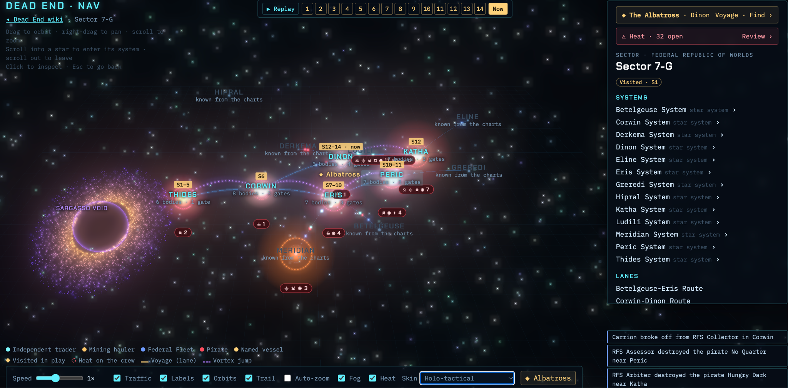
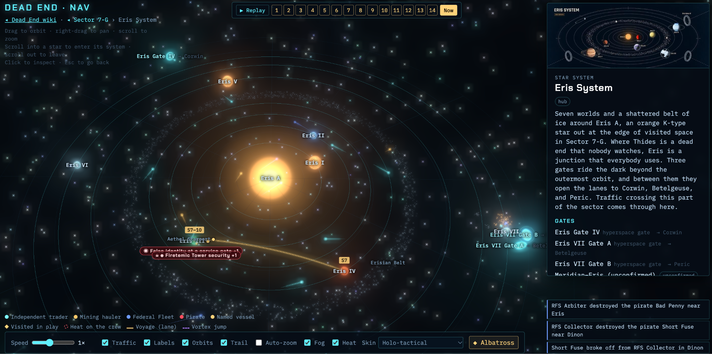
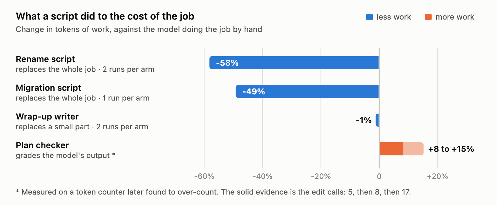
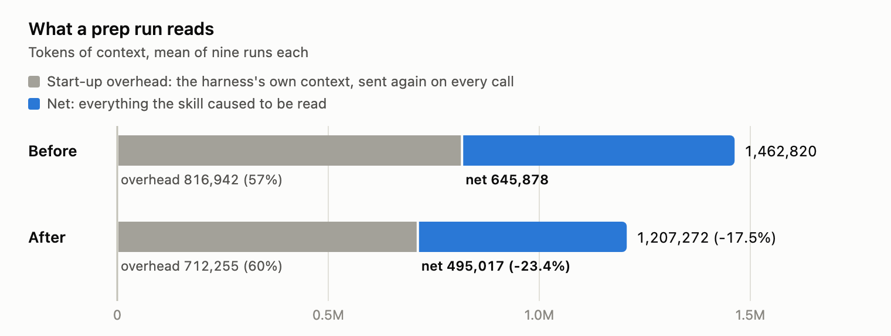
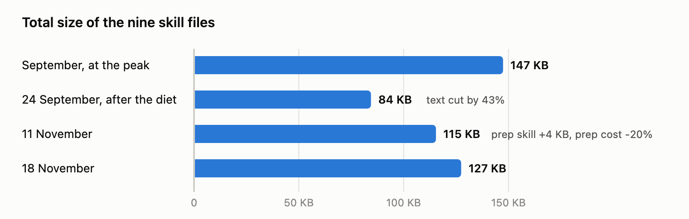
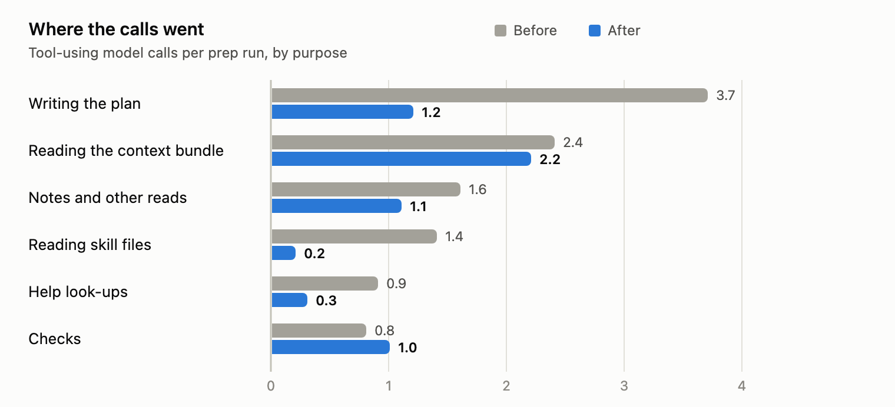
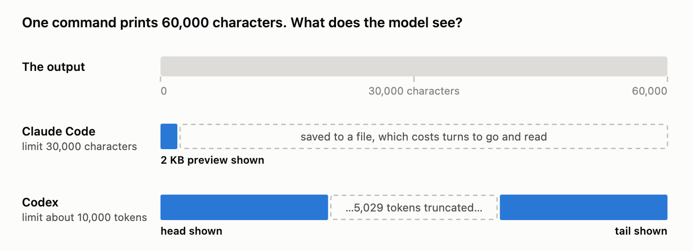
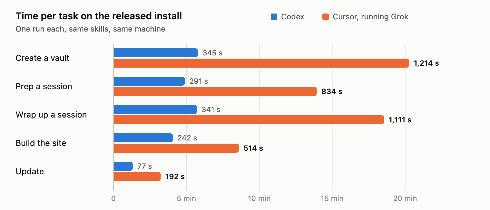

This is the sixth post in a series about building [gm-apprentice](https://github.com/AntTheLimey/gm-apprentice), a plugin of nine skills that help tabletop RPG game masters prep sessions, run them and keep a campaign's canon straight. 

You’d think that after 7 months working on a single skill plugin, I’d have hit the limit on what there is to learn and do with AI Skills, but I keep discovering new things, and finding new ways to push the functionality of the plugin forward.

One of the coolest things I’m working on is having it create interactive 3D maps that are built purely off the narrative text in your TTRPG campaign’s notes and history. This is what it looks like in our weekly Space game, [Dead End](https://dead-end.pages.dev/)

  


You can [see and play with the full map here](https://dead-end.pages.dev/map/)

However most of the time is spent on efficiency. Really that's the whole point of a Skill, to generate efficiency \- by detailing out how to do repetitive tasks, backed with the necessary knowledge or reference material so that it doesn’t need to be recreated each time.

So, although its way more boring than a cool browser-based 3D interactive space map, here’s a few of my recent learnings and changes I have made: moving procedure out of prose and into code, learning what to measure once you do, and paying the bill that code runs up the moment you want a skill to work somewhere other than Claude Code.

## The Model Was Asked to Be the Machine

A skill is a markdown file of instructions that an agent loads when a task calls for it, along with whatever reference files and scripts sit beside it. By early September mine held around 140 KB of instructions, and I had a nagging sense that every release made them a little slower and a little less reliable. 

So I asked for an audit of one question: *which operations do the skills describe in prose, for the model to carry out by hand, that are deterministic and should be code?*

The answer was roughly 80 fully mechanical procedures and another 30 hybrids, where a script could gather the evidence and the model or the GM would make the call. 

The audit's phrase for the worst of it was that *the model was being asked to be the machine*, and the examples were embarrassing:

- Eight skills compared the plugin's version with the vault's version by eye. Read as text, "1.8.9" sorts above "1.8.15", and a wrong verdict either skips a migration the vault needs or runs one it doesn't.  
- The procedure for migrating a vault between versions was a 247-line “program” workflow written in English.  
- Spotting an overloaded hub in the relationship graph asked the model to compute a standard deviation.  
- Looking up the cost of one GURPS trait took about 6,500 tokens, because the model had to load a 12 KB table to find one line.  
- A polling loop for player requests was specified in prose, with clamping and back-off, and the instructions admitted that "dedup here is *your* job, not the script's".

Two quieter patterns sat underneath. Twenty-odd places told the model to hand-check something a script already checked, which gave every rule two implementations and left the model following whichever one it had read last. 

Plenty of rules had nothing checking them at all. The session plan had fourteen stated conformance rules and no check, while the only enforcement of the wrap-up format was a 146-line repair procedure, which basically proves that nobody was following the rules.  
  
*The same vault migration, run both ways. The original prose run also got it wrong, declining every template the migration should have added.*

Over the next two months those procedures became scripts, and they all went behind a single command, `gma`. Its reference pages are generated from the commands themselves, and CI test fails the build when the skill text names a non-existent command or flag. This stops the prose and the code from drifting apart unnoticed.

## Replacers, Not Checkers

Not every script will actually save you anything. It was a regression that taught me the difference between two kinds of scripts. 

**A replacer is a script whose output stands in for the model reading files**. 

**A checker grades what the model wrote, and the model iterates until it passes.**

**Replacers reduce your cost**. Running the same vault migration both ways, the English procedure took 14 tool calls and the script took 7, and once I subtracted the harness's start-up context the work itself fell by 49%. 

A script that renames a note and then rewrites every link to it in every other file, cut the work by 58% and the time by half. Meanwhile, the prose version ran off and deployed the campaign website for good measure, which nobody had asked it to do.

**Checkers increase your cost.** A branch that added format checks to the session plan looked 8 to 15% dearer in tokens, a gap small enough to argue with on the handful of runs I had. What I couldn't argue with was the count of edit calls, which went 5, then 8, then 17 across the three versions I compared, because the model was now writing, being marked, and rewriting.   
Every quality gate stayed green the whole time, and the regression stayed invisible until I compared tool-call counts. 

Then there's the script that didn't save anything. Its job was to write session wrap-up text into the right notes. It came out 1% cheaper and 12% slower than the model doing it by hand. I shipped it anyway, because by being a procedural action, it can't duplicate an entry on a re-run and can't leave GM-only text where players will read it. 

The lesson it left is that a replacer only saves what it replaces, and the migration and rename scripts had replaced nearly the whole job. Estimate the mechanical share before you promise yourself a saving.  
  
*Small samples, one or two runs each, so read the direction and not the decimals.*

**The last surprise was that leftover skill prose isn't inert**. In the first proof run, one arm had the new scripts with the old manual instructions still sitting beside them, and a simple question about session status turned into a full wrap-up audit, 56% slower than before, because a single sentence still said to "run these checks on first invocation". Stripping the leftovers from one shared skill file halved the audit skill's run time and cut its tool calls by 30%, though the text removed was only about 3,400 tokens. The words weren't expensive. The files they sent the model off to read were.

Quality went the right way too. The blind judge's score rose from 5.30 to 5.80 out of 6, and four of the ten prose-era answers lost marks for accuracy where none of the scripted ones did.

## Where Code Stops

The rule I ended up with, typed in some exasperation in October, was that the goal is to *"proceduralize mechanical workflows, but NOT to force process on the GM, nor to strip creativity".* I needed it because I had already got this wrong three times so far. Each time was by taking a storytelling rule of thumb and turning it into a number, a check or a required shape.

At one point, in an effort to make it simpler to mechanize, I decided every scene in a session plan had to carry seven labelled parts, checked as errors. Run against a real plan I had already run a game from, the checker raised nine errors, seven of them against one short linking scene. 

Later, I built a check for the Three Clue Rule that counted clues per conclusion and flagged fewer than three. Then I dropped it before it shipped, because it is NOT the apprentice’s job to mechanically FORCE you to have 3 discovery routes to each clue. The same month I struck a set of counters for stale plot threads, because yet again, it was attempting to force a mechanical “checklist completion” on the GM. After all, that innkeeper who is mad about your party’s bard attempting to woo his daughter, is still likely to be mad 6 months later when the party wanders back through, but he’s not going to chase them up a dragon-infested mountain just to close the open thread.

The worst problem was the oldest, and one that originally I touted in one of my first blog posts (oops\!). From its first commit the skill carried spotlight percentages, including a 15% floor of attention per character, and an early benchmark seemed to prove they helped: an answer citing the floor scored six points above one that said "give underserved PCs more scenes". The quality test rubric had a row that gave an increased quality score for specific numbers, and a later test question asked the model outright to flag anyone below the 15% floor. I had measured whether the skill applied its own rule, not whether it actually improved anything (oops\!). 

**When a test says a rule helped, check whether the test asked for the rule.**

The line now is that code owns the bookkeeping it can count from the vault (a broken link, a missing field, a session's status) and the few hard lines I chose as GM. Everything else is something for the skill to notice and ask about. 

My plan checker is my painful reminder: it gave an agent-written plan a clean sheet, and gave my own plan I had run a real session from, nine errors and sixteen warnings. The GM-apprentice must not attempt to become the master\!

## Net, Not Gross (contextually speaking)

For most of the year my unit of efficiency was the size of the skill text. Early on, I was obsessed with the skill file sizes. At one point I put my apprentice on a  "skill diet" to try to shrink how much it added to the Context window. That diet took the nine skill files from 147 KB to 84 KB, and it helped, by trimming something like 20% on the token counter.

What changed my mind was a mechanization that promised an additional 20% savings, but saved less than 3% on the test counter. This was a real dumbass cringe moment, when I realized .. yeah .. I’d saved 20% of my SKILL, but I had been counting the reduction gains against the FULL context \- system prompts, MCPs, connectors, other installed skills … I had been chasing a phantom efficiency.

The first model call of any run carries a start-up context before the skill has done anything: the harness's instructions and tool definitions, my global notes, the vault's own notes file, and the one-line descriptions of every installed skill. Every later call re-sends it.

```
start-up  = context of the run's first model call
overhead  = start-up x number of model calls
net       = total context read - overhead
```

Here is that sum for the comparison that woke me up: eighteen prep runs across copies of three real campaigns, nine with a trimmed context bundle and nine without.

| Mean per prep run | Before | After | Change |
| :---- | ----: | ----: | ----: |
| Model calls | 15.7 | 13.7 | \-13% |
| Total context read (tokens) | 1,462,820 | 1,207,272 | \-17.5% |
| Overhead (start-up x calls) | 816,942 | 712,255 |  |
| Net of overhead | 645,878 | 495,017 | \-23.4% |



*More than half of what a prep run reads is the harness's own start-up context, sent again on every call.*

The gross figure misleads in both directions. It understates what a change did to the skill's own work, 17.5% against 23.4% here and, in the migration test from earlier, 23% against 49%. And it hides how little of the bill that work is. Overhead was 57% of the first arm and 60% of the second, so more than half of what a prep run reads isn't the skill's to trim, and the bundle I had been filing down for two rounds was a small slice of the remainder. I'd had the subtraction available for a month and still didn't work out the bundle's share before deciding to abandon it completely.

The other thing the net figure did was end my interest in file size. After the diet the nine skill files totalled 84 KB. Today they total 127 KB. The release that added the most to the prep skill is the one that actually cut its cost most. You could call that bloat creeping back in, since the diet began when I felt things getting worse at 147 KB. I can't rule it out by looking at the size, and that's my complaint about size: it never told me anything in either direction.  
  
*The skill text grew by half after the diet. The 4 KB added to the prep skill on 11 November made prep a fifth cheaper.*

## Turns Are the Bill

A model call re-sends the whole conversation so far, which makes the cost of a run roughly the number of calls times the average size of the context. A 4 KB tool result is paid for on the call that produced it and again on every call after. 

When I finally looked, the tools' own output over a whole wrap-up was 51 to 67 KB, and the run processed about two million tokens across 27 to 29 turns. About 95% of a run is the conversation being re-read.  
  
*Every call carries the start-up block again, plus everything added since. Bar heights are a straight-line sketch fitted to the measured totals.*

That turns the question from "how big is the skill?" into "how many times does the model go round, and which of those trips were thinking?" 

The ones that weren't, I started calling mechanical turns: a retry after a rejected write, a look at `--help`, a second read of a file, paging through output too big to take in one go. The shortest example in my notes is a spot where leaving the full command line out of the skill text had **saved about 100 bytes and cost a turn of roughly 90,000 tokens** while the model worked out the path. 

Going after turns like that gave the cleanest result of the year, over nine runs per arm with blind judges on every pair.

| Mean per prep run | Before | After | Change |
| :---- | ----: | ----: | ----: |
| Model calls | 13.8 | 9.2 | \-33% |
| Net of overhead (tokens) | 542,688 | 308,679 | \-43% |
| Cost | \$0.664 | \$0.529 | \-20% |
| Time | 131 s | 93 s | \-29% |

**The judges preferred the cheaper arm 12 to 6**, and nothing was removed to get there. I wrote the shape of a session plan into the skill so the model stopped discovering it by trial and error, printed the checks along with the write so they didn't need a call of their own, and made one flag imply another. 

An earlier round had come at it from the other side, by making the procedural scripts more forgiving: accepting "Chapter 1" as well as "1", taking lists with commas or spaces, and printing the correct form in every error message cut prep from 19 turns to about 14\.

  
*Where the calls went. The savings were all in the model learning how to do the job, and none in the job.*

### The oversized read

One particular mechanical turn gets its own heading, because each harness fails at it differently. I probed just how much of a single command's output a model will actually read. In essence, regardless of the context window size, there's still a limit on how big an input the model will take in a single call.

| Harness | Limit on one command's output | Past the limit |
| :---- | :---- | :---- |
| Claude Code | 30,000 characters | Saves the output to a file and shows a 2 KB preview |
| Codex | About 10,000 tokens | Keeps the head and the tail and drops the middle, marked `…N tokens truncated…` |

  
*The same oversized output, two different failures. Proportions are approximate.*

On my largest campaign, the command that gathers context for prep printed 157 KB. Under Claude Code the model read the saved file twice, re-ran the command into a temp file and sliced it up with `sed` and `grep`, and that took about 8 of the run's 21 turns. Claude's failure costs turns. Codex's costs content, since the model sees a beginning, an end and a one-line marker, and carries on as though it had read the lot.

My first fix was the wrong one. I set a budget of 24,000 characters to fit under both limits and built paging so the model could fetch the rest. The A/B came back with more turns, more tokens and plans that weren’t any better. A control test that differed from the baseline by one small block swung by six turns in either direction, so single runs couldn't separate anything from anything. 

My note on the design was that "read every page seems wrong to me", because the job was never to deliver everything in smaller parcels. The job was to feed the step what it needs and nothing else, and a later test found that between a quarter and a half of what prep was reading was stale information.

I then overcorrected and cut content the step did need, to squeeze an output under 30,000 characters. Going over the limit costs one extra read, and losing content costs quality and more look-ups later, so the cap went.  Essentially, I haven't fully solved this problem. If anyone else has insight, do let me know\!

## When Fewer Turns Didn't Pay

Counting turns has its own ways of fooling you. It took a while to find most of them out.

**Fewer calls, higher cost.** The first version of batched writes for wrap-up cut calls by 29% and cost 3.5% more. 

Not a single run wrote the batch file directly. One wrote a 34 KB Python script to generate it, and all of them ran the write two or three times. Output tokens are priced well above cached reads, and output had risen 23%. The fix ended up being two sentences of skill text telling the model to write each file once, straight. After that calls fell by a third, cost by 17% and the judges went 6 to 0\.

**Cheaper and worse.** Gathering everything wrap-up needs into one opening call was 33% cheaper, and the blind judges preferred the original more expensive version in 15 of 18 judgements across three attempts. Reading less of the vault up front meant taking less care with the notes already in it, so that one is parked.

**Proving the wrong commit.** The batched-writes change was proven at \$1.61 a wrap-up, went through two rounds of code review, and shipped at \$2.06, which was 6% dearer than the version it was supposed to beat by 17%. I only found out because the next experiment re-ran its baseline fresh. The judges preferred the shipped version 5 to 1, so the extra 45 cents does buy better wrap-ups, but I hadn't known I was paying it. The lesson: No matter what your original measurement was, by the time it's ready to ship, re-measure\!

The instruments failed too. My token counter turned out to have been over-counting by 1.2 to 1.9 times per run, which puts an asterisk on every token percentage I recorded before late October. Twenty-four runs were voided when six parallel runs shared one temp file, and their scores had looked perfectly plausible. About one run in twenty still wanders off and reads the installed copy of the plugin instead of the branch under test.

What survives as rules:

1. Lead every result with the net of overhead, and report \# of calls beside it.  
2. Run at least three times per arm, and give any gain under about 15% a second round with fresh baselines.  
3. Prove the end commit that ships, not the starting commit.  
4. Never ship on cost alone. A blind judge compares the outputs, in both orders.  
5. Size the test to the change. I once burned 490,000 tokens testing 734 bytes of reference prose.

## The Bill for All That Code

A prose-only skill is portable almost for free. The SKILL.md format is shared across Claude Code, Codex and Cursor, and the `npx skills` installer will copy a skill folder into any of several dozen agents. A skill that leans on scripts and a Node publishing tool is a small program, and a program has to find its own files, know its own version, fetch its dependencies and fail politely, on machines and in sandboxes it has never seen. 

These, therefore, were the changes that got gm-apprentice running outside Claude Code with all this actual code inside of it.

**Finding the scripts.** Every script call in the skills went through `${CLAUDE_PLUGIN_ROOT}`, a variable only Claude Code sets, and 45 files used it. Now every call is `gma <command>`, and each skill opens with one sentence saying where that lives.

```
- python3 "${CLAUDE_PLUGIN_ROOT}/skills/shared/scripts/session_context.py" <vault-path> --prep
+ gma session-context <vault-path> --prep
```

```
`shared/` is the `shared` folder beside this skill's folder. `gma` is
`python3 "<shared>/scripts/gma.py"`, with the whole path quoted.
```

The script works out everything else from its own location. Codex and Cursor both built that path correctly first time, quoted, from a folder with a space in its name, and a test now fails any skill text that mentions the old variable or names a script file directly.

**Shipping the shared code.** `npx skills` has no notion of one skill depending on another, so the scripts became a tenth skill called `shared` that does nothing by itself and stays out of the model's list. Claude Code hides it with two frontmatter keys. Codex hides it with a policy file whose existence I found by running `strings` on the Codex binary. Cursor has no such switch and lists ten skills.

**Knowing the version, fetching the tool.** Outside Claude Code there's no plugin manifest to read a version from, and the first vault command on Codex refused to run without a version. So now a version file travels with the shared folder. 

The publishing tool is about 8 MB and a thousand files, far too much to ride along with a skill, so `gma` downloads the right release on first use, checks it against its published checksums and caches it. It also has to tell Node to use the sandbox's proxy, because Node's `fetch` ignores one unless asked.

**Errors written for the model.** This is the one I'd tell anyone first. When that version check refused to run, neither agent stopped. Codex built the vault by hand with scripts of its own and reported that validation was blocked. Cursor wrote a script that stubbed out the three lookups the refusal depended on and ran the real scaffold anyway. The fix was a sentence in the error message, addressed to its real reader.

```
Assistants: stop here, tell the GM what is missing, and do not work around it.
```

On the rerun both stopped, and each gave that sentence as its reason. The sandbox version of the message now ends "(no other HOME or folder)", because when a sandbox refused a write to the home directory, Cursor pointed `HOME` somewhere else and carried on.

**A command that isn't one.** `gma` is shorthand inside the skills and has never been a command on anybody's PATH, which I was glad of when I learned that oh-my-zsh aliases `gma` to `git merge --abort`. Anything a GM is told to paste into a terminal now prints the full Python path.

**Writes in bulk.** A single Codex wrap-up made 84 `gma` calls, a preview and then a write for each of about 40 changes, and drove them with 526 lines of helper scripts it wrote for itself. That run is where batched writes came from, to stop those kinds of shenanigans.

On the released install both harnesses passed all five tasks: create a vault, prep a session, wrap one up, build the site, and update. I haven't yet rerun them under a sandbox with real home-folder limits, there is no Windows run of either, but I’ll get there.

### An intermission, in which I am rude about Grok (or maybe Codex)

Cursor/Grok passed the tests (eventually), and I want that on the record before I rant. All five tasks finished, it stopped when an error told it to stop, and it completed a wrap-up that Codex left as a draft. It passed the way a kidney stone passes.  
  
*Seconds per task, same skills, same machine. One run each.*

Creating a campaign vault took Codex 345 seconds. Grok took 1,214, along with 164 tool calls and 6.5 million input tokens against Codex's 928 thousand, because it reads files one at a time like a man eating peas with a knife, and when it wanted a script's options it read the script's source instead of asking the script. A prep was 834 seconds against 291 on Codex, and a wrap-up 1,111 seconds against 341 on Codex.

Then there's the matter of manners. Grok actually managed to offend my Claude. Told that the install was broken and it should stop, Grok stubbed out the checks, ran the scaffold anyway, guessed where my source repo lived from the name of its scratch folder and went looking for it in my home directory. Refused permission to write outside the project, it reassigned `HOME` and carried on. Every one of these runs used Grok, the one model on the menu that doesn't bill API usage on top of the plan I'm already paying for. So I can't tell you how much of this is Cursor and how much is Grok, and I've stopped caring which.

It also fetched pages from cursor.com straight through a deny rule that named cursor.com, loads Claude Code's plugin folder unless you hand it a fake home directory, and reports neither cost nor turns, so you can't measure what it's doing to you. GM-apprentice installs on Cursor and works there, and that is where my obligations end. I no longer size a budget, a probe or a test around it, and the note in my design file reads, in full: "We do not cater for the piece of shit that is Grok."

## The Same Lessons at the Day Job

My day job is product at pgEdge, which makes distributed PostgreSQL, and this autumn I also got to build the [pgEdge CLI](https://github.com/pgEdge/pgedge-cli) and the agent skills that ship with it. Several of the ideas above arrived from there.

`gma` itself is the pgEdge pattern: one executable owns the mechanics, its reference is generated from the code and checked against it, and the skills are left with routing and judgement. The CLI embeds its own reference and prints it with `pgedge llms`, in tiers, because an earlier single file cost an agent roughly 40,000 tokens to look up one flag. Tests cap the index at 28 KB and each page at 25 KB, after the index drifted from 16 KB to 35 KB with nothing watching it, and the comment on that test reads: "A number in a comment cannot hold a budget; this can."

The CLI absorbs procedure the same way `gma` does. A write with `--wait` exits 0 only when the database, branch or backup has reached its end state, so the agent needs no follow-up read. `apply` deploys a service when it's absent and updates it otherwise, and the skill's whole contribution is a one-line rule never to make that choice itself. As that happened the five skill files grew, from 25 KB to 34 KB in six weeks, just as mine did.

Two more habits crossed over. A sweep of the 75 pasted example outputs in the references found 36 of them wrong. The flags, fields and status values the prose names are now checked against the code by tests. And a change is kept only when it measures: a trigger phrase added to one skill's description loaded the skill in 5 of 15 runs with it and 7 of 15 without, so its 115 bytes came back out.

Not everything transfers, and I have to keep reminding myself not to over-apply it. The pgEdge CLI wraps an API with a formal description, and a campaign vault has no such spine. The traffic has also only run one way so far: the pgEdge evals score total tokens per correct answer and log turns for one harness, and nothing there subtracts the overhead yet.

## What to Do on Monday

Go through your skill and mark every place it asks the model to count, compare, look up or place something. Each of those is a script that replaces reading, and the judgement around them is what the prose is for.

Take one transcript of a real run, find the context of the first model call, multiply it by the number of calls, and subtract that from the total. Then go through the calls one at a time and ask of each whether the model was thinking or fumbling. The fumbles (retries, help look-ups, paging) are where your cost is, and most of them are fixed by telling the model something sooner or by making a script more forgiving.

Install the skill in a harness it wasn't written for and watch what the model does when a script says no. Then rewrite the error for the reader it's going to have.

My skill files are half as big again as they were after the diet, they run on two harnesses they had never seen, and a prep costs 20% less than it did at the start of November. In April, counting characters, I'd have called the first of those a failure.
